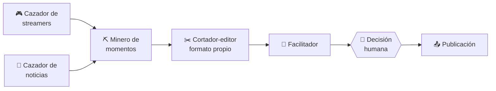
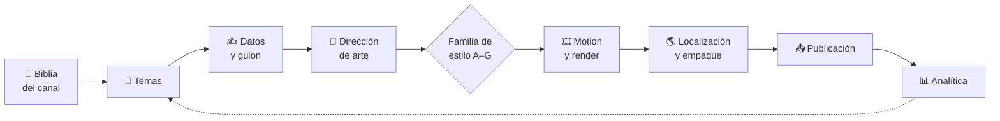

# 🎬 Niche Studio

**Estudio de contenido de video corto impulsado por IA**

*Marcas descentralizadas · Operaciones centralizadas*

---

> **Principio rector:** construir primero una operación rentable y replicable;
> automatizar después lo que demuestre generar valor.

## 📌 Qué es

Niche Studio es un portafolio de canales de video corto operado por dos socios sobre una
infraestructura compartida. Tiene dos líneas de negocio que se miden por separado:

| | ✂️ Línea A · Clipping | 🎨 Línea B · Faceless original |
|---|---|---|
| **Qué produce** | Clips de streamers y de noticias, con formato propio | Piezas con guion y visuales propios |
| **Cómo trabaja** | Reactivo: cazar, cortar, dar formato, entregar | Proactivo: diseñar, producir, construir audiencia |
| **Agentes** | 5 y una puerta humana | 9 y cuatro puertas humanas |
| **Ingreso** | Por validar: tráfico, campañas opcionales | Plataforma, afiliados y patrocinios |

## 🔄 Cómo funciona

Son dos flujos distintos, no un pipeline con dos configuraciones.

**✂️ Clipping**

**🎨 Contenido propio**

Cada agente es hoy un rol con contrato que ejecuta una persona con un prompt o un script.
Se automatiza solo después de repetirse con resultado estable.

## 📚 Documentos

| # | Documento | Qué contiene |
|---|---|---|
| 00 | [Decisiones fundacionales](docs/00-decisiones-fundacionales.md) | Decisiones de los socios, modelo de capacidad, tensiones abiertas |
| 01 | [Business Blueprint](docs/01-business-blueprint.md) | Modelo de negocio, vías de ingreso, economía unitaria, MVP |
| 02 | [Hechos verificados](docs/02-hechos-verificados.md) | Monetización y políticas por plataforma, con fuente y nivel de confianza |
| 03 | [Gobernanza mínima](docs/03-governance-minimo.md) | Reglas, niveles de riesgo, registro de derechos, control previo a publicar |
| 04 | [Herramientas de producción](docs/04-herramientas-produccion.md) | Catálogo y guía "qué video → qué herramienta" |
| 05 | [SOP · Base compartida](docs/05-sop/00-base-compartida.md) | Por qué hay dos flujos, niveles de automatización, archivos, ClickUp |
| 05 | [SOP · Flujo de clipping](docs/05-sop/01-flujo-clipping.md) | Cazadores, Minero, Cortador-editor con formato propio, Facilitador |
| 05 | [SOP · Flujo de contenido propio](docs/05-sop/02-flujo-contenido-original.md) | Nueve agentes y enrutamiento por familia de estilo (A–G) |

## 🗺️ Hoja de ruta por olas

| Ola | Semanas | Enfoque | Estado |
|---|---|---|---|
| **0** | 1–2 | Fundamentos y verificación, sin publicar | 🟡 En curso |
| **1** | 3–6 | Dos canales en español, producción manual cronometrada | ⚪ Pendiente |
| **2** | 7–10 | Pipeline propio; canales nuevos según capacidad | ⚪ Pendiente |
| **3** | 11–13 | Revisión del portafolio | ⚪ Pendiente |

## 🧩 Los diez módulos

| # | Módulo | Estado |
|---|---|---|
| 1 | Business Blueprint | 🟢 Primera versión |
| 2 | Channel Strategy | ⚪ Siguiente |
| 3 | Operating Model | ⚪ Pendiente |
| 4 | AI Agent Architecture | 🟡 Parcial: agentes definidos en el SOP, sin automatizar |
| 5 | Content Production SOP | 🟢 Primera versión |
| 6 | Technology Stack | 🟡 Parcial: catálogo de producción |
| 7 | Financial Model | ⚪ Pendiente |
| 8 | Performance Framework | ⚪ Pendiente |
| 9 | Risk & Governance | 🟡 Versión mínima |
| 10 | 90-Day Roadmap | 🟡 Esbozo por olas |

## 🛠️ Herramientas

Solo opciones gratuitas por ahora.

| Uso | Herramientas |
|---|---|
| Corte y subtítulos | ffmpeg · Whisper |
| Composición de video | [HyperFrames](https://github.com/heygen-com/hyperframes) |
| Estilos y recetas | [Lemo Opuscar](https://github.com/lemomo-ai/lemo-opuscar) · [Video ShotCraft](https://github.com/Vincentwei1021/video-shotcraft) · [pixelfx](https://github.com/patch-gg/pixelfx) · [Claude Animation Base](https://github.com/JohnHeibel/ClaudeAnimationBase) |
| 3D | [Three.js](https://github.com/mrdoob/three.js) · [React Three Rapier](https://github.com/pmndrs/react-three-rapier) · [React Postprocessing](https://github.com/pmndrs/react-postprocessing) · [Blender MCP](https://github.com/ahujasid/mcp-for-blender) |
| Audio | [librosa](https://github.com/librosa/librosa) |
| Prompts de referencia | [awesome-opus5-5-videos](https://github.com/yihui-dev/awesome-opus5-5-videos) · [opus-video-prompts](https://github.com/joeseesun/opus-video-prompts) |

Qué usar según el tipo de video: ver la [guía de selección](docs/04-herramientas-produccion.md#2-guía-de-selección-qué-video-qué-herramienta).

## ⏳ Por definir

- Acuerdo entre socios: reparto de ingresos y titularidad de las cuentas.
- Tema del primer canal original (saldrá del scoring del Módulo 2).
- Confirmación de los datos de monetización contra las páginas oficiales.

## ⚠️ Sobre los datos

Las páginas oficiales de las plataformas no se pudieron leer al preparar el documento 02.
Sus datos vienen de fuentes secundarias y deben confirmarse antes de decidir sobre ellos.
