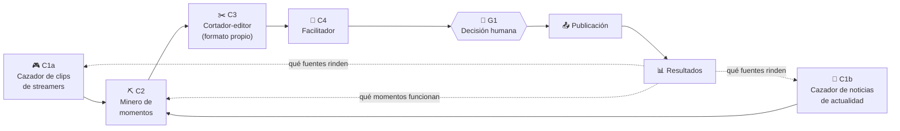

# 05 · SOP · Flujo de clipping

**Cazar, cortar, dar formato, entregar.** Fecha: 2026-11-13.

El estudio saca clips de streamers y de noticias de actualidad y los resube con un formato
propio para ganar visitas. Las campañas pagadas son una vía opcional, no el punto de partida.

## 1. Mapa del flujo



| Agente | En una línea | Nivel inicial |
|---|---|---|
| C1a Cazador de clips de streamers | Encuentra streams y momentos que valen la pena | 0 |
| C1b Cazador de noticias de actualidad | Encuentra noticias con video y conversación | 0 |
| C2 Minero de momentos | Ubica el momento exacto dentro del material | 1 (transcripción y picos) + 0 (selección) |
| C3 Cortador-editor | Corta y aplica el formato propio del canal | 1 |
| C4 Facilitador | Entrega lo hecho, explica las decisiones y recomienda prioridad | 0 |

Hay una sola puerta humana (G1), al final. Los dos cazadores alimentan carriles separados:
streamers y noticias no comparten cuenta ni plantilla.

## 2. Agentes

### C1a · Cazador de clips de streamers

| | |
|---|---|
| **Misión** | Mantener una cola de fuentes de streamers con potencial de vistas |
| **Disparador** | Ronda diaria; además, aviso de un directo o polémica en curso |
| **Entradas** | Mapa de streamers del canal (nombre, plataforma, idioma, horario habitual); tendencias en TikTok, X y YouTube; resultados anteriores |
| **Salidas** | Cola de fuentes: enlace, streamer, hora aproximada, motivo, puntaje, si ya circula en redes, si el streamer tiene campaña de clipping activa |
| **Herramientas** | Navegador; búsqueda con Claude, ChatGPT o Gemini; ClickUp |
| **Límites** | No descarga ni corta. No añade streamers al mapa sin anotarlo en la ficha del canal |
| **Fallas típicas** | Llegar tarde (el momento ya lo subieron diez cuentas); perseguir a un streamer que reclama clips |
| **Aprobado si** | Cada fuente tiene enlace que funciona, motivo en una frase y puntaje |

**Puntaje de fuente (1–5 por criterio):**

| Criterio | Peso | Pregunta |
|---|---|---|
| Potencial de vistas | 35% | ¿El streamer o el tema mueven audiencia hoy? |
| Frescura | 25% | ¿Cuántas horas tiene? ¿Cuántas cuentas ya lo subieron? |
| Encaje con el canal | 20% | ¿Calza con el idioma y el nicho del canal? |
| Riesgo | 20% | ¿El streamer tolera clips? ¿Hay música o terceros? (5 = riesgo bajo) |

### C1b · Cazador de noticias de actualidad

| | |
|---|---|
| **Misión** | Mantener una cola de noticias con video disponible y conversación activa |
| **Disparador** | Dos rondas diarias (mañana y tarde); además, noticia de última hora |
| **Entradas** | Lista de medios por país (Chile, Argentina, México, España, EE. UU.); tendencias por país; resultados anteriores |
| **Salidas** | Cola de noticias: titular, fuente del video, país, contexto en dos líneas, puntaje, **nivel de sensibilidad** |
| **Herramientas** | Navegador; búsqueda con Claude, ChatGPT o Gemini; ClickUp |
| **Límites** | No propone noticias sin una segunda fuente que las confirme. No decide publicar temas sensibles |
| **Fallas típicas** | Noticia falsa o sacada de contexto; video cuyo dueño reclama rápido; tema que la plataforma restringe |
| **Aprobado si** | Cada noticia tiene dos fuentes, contexto y nivel de sensibilidad marcado |

**Puntaje de noticia (1–5 por criterio):**

| Criterio | Peso | Pregunta |
|---|---|---|
| Alcance | 30% | ¿A cuánta gente del país le importa? |
| Vigencia | 25% | ¿Seguirá siendo tema en 24 horas? |
| Fuerza del video | 25% | ¿La imagen se entiende sola, sin explicación larga? |
| Riesgo | 20% | Derechos del medio y sensibilidad del tema (5 = riesgo bajo) |

**Nivel de sensibilidad:**

| Nivel | Ejemplos | Tratamiento |
|---|---|---|
| Bajo | Curiosidades, deportes, espectáculos, tecnología | Flujo normal |
| Medio | Política, economía, polémicas con personas nombradas | El Facilitador lo destaca; la persona revisa el contexto antes de aprobar |
| Alto | Muertes, violencia, menores, acusaciones sin sentencia, salud | No se produce sin decisión humana previa (Regla 10) |

### C2 · Minero de momentos

| | |
|---|---|
| **Misión** | Encontrar dentro de cada fuente los momentos que funcionan como clip |
| **Disparador** | Una fuente nueva en la cola con puntaje sobre el umbral del canal |
| **Entradas** | Video o audio de la fuente |
| **Salidas** | `momentos.md`: por cada candidato, inicio y fin, frase textual, hook propuesto, por qué funciona, puntaje |
| **Herramientas** | Whisper (transcripción con marcas de tiempo), librosa (picos de audio), un modelo de lenguaje sobre la transcripción |
| **Límites** | No inventa contexto que no esté en el material. No propone momentos que solo se entienden habiendo visto el stream completo |
| **Fallas típicas** | Transcripción mala con jerga o varios hablantes; momentos que empiezan tarde o cortan la reacción |
| **Aprobado si** | Cada candidato tiene marcas de tiempo exactas y se entiende sin contexto adicional |

**Procedimiento:**

1. Extraer el audio.
2. Transcribir con marcas de tiempo.
3. Detectar picos de volumen (gritos, risas, reacciones).
4. Pasar transcripción y picos al modelo con el prompt de abajo.
5. Guardar `momentos.md`.

**Puntaje de momento (1–5 por criterio):**

| Criterio | Peso | Pregunta |
|---|---|---|
| Gancho en 2 segundos | 30% | ¿La primera frase o imagen detiene el scroll? |
| Autosuficiencia | 25% | ¿Se entiende sin haber visto el resto? |
| Emoción o remate | 25% | ¿Hay risa, sorpresa, enojo o cierre claro? |
| Duración adecuada | 20% | ¿Cabe entre 20 y 60 segundos sin relleno? |

**Prompt base:**

```text
Eres el Minero de momentos de un canal de clips en <idioma> sobre <nicho>.
Te entrego la transcripción con marcas de tiempo de <fuente> y una lista de
segundos con picos de volumen.

Propón hasta 8 momentos para clips verticales de 20 a 60 segundos. Para cada uno:
- inicio y fin (hh:mm:ss), empezando 1 segundo antes de la primera palabra clave
- la frase textual con la que abre
- un título-gancho de máximo 6 palabras, sin inventar hechos
- por qué funciona, en una frase
- puntaje 1-5 en: gancho, autosuficiencia, emoción, duración
- riesgos: música de fondo, terceros nombrados, tema sensible

Descarta momentos que requieran haber visto el resto del video.
Ordena por puntaje total. No inventes nada que no esté en la transcripción.
```

### C3 · Cortador-editor

| | |
|---|---|
| **Misión** | Convertir cada momento aprobado por puntaje en un clip vertical con el formato propio del canal |
| **Disparador** | `momentos.md` listo |
| **Entradas** | Video fuente, marcas de tiempo, título-gancho, transcripción, plantilla del canal |
| **Salidas** | Clip 1080×1920 terminado, con subtítulos, título y marca |
| **Herramientas** | ffmpeg; HyperFrames para plantillas animadas |
| **Límites** | No cambia la plantilla del canal. No altera el sentido de lo dicho con cortes internos |
| **Fallas típicas** | Subtítulos desfasados; título que tapa la cara; corte que empieza a mitad de palabra |
| **Aprobado si** | Formato 9:16, plantilla del canal aplicada, subtítulos sincronizados, audio limpio |

#### El formato propio

Un video horizontal puesto en una pantalla vertical deja franjas vacías. El formato propio
del canal consiste en **diseñar ese espacio**: es lo que hace reconocible al canal y lo que
diferencia el clip de una resubida sin cambios.

| Disposición | Cómo se ve | Sirve para |
|---|---|---|
| A · Clip centrado sobre fondo de marca | El clip al centro; arriba el título, abajo los subtítulos, sobre un diseño o video de fondo en bucle | Formato base; el más flexible |
| B · Fondo desenfocado del propio clip | El mismo clip ampliado y difuminado detrás | Rápido y limpio; poca identidad de marca |
| C · Pantalla dividida | El clip arriba y otro video abajo (reacción, gameplay, visual hipnótico) | Retención en clips largos o de solo voz |
| D · Recorte a pantalla completa | Se recorta el horizontal para llenar el vertical, siguiendo a quien habla | Cuando importa una sola persona en pantalla |

Cada canal fija **una** disposición y sus elementos en su ficha:

| Elemento | Qué se define |
|---|---|
| Disposición | A, B, C o D |
| Fondo | Diseño estático, animación en bucle o video; paleta del canal |
| Título-gancho | Tipografía, tamaño, posición, color, animación de entrada |
| Subtítulos | Tipografía, color, borde, posición, palabra resaltada o no |
| Marca | Logo o nombre del canal y dónde va |
| Cierre | Medio segundo final con el nombre del canal o llamado a seguir |
| Crédito | Nombre del streamer o del medio, siempre visible |

Dos canales no comparten plantilla (Regla 16 de `03`). La plantilla se construye una vez y
vive en `Niche-Media/clipping/<canal>/_plantilla/`.

#### Comandos de referencia

Probados el 2026-11-13 con ffmpeg 6.1 sobre un video sintético. Todos entregan 1080×1920.

**Cortar el momento:**

```bash
ffmpeg -ss 00:10:00 -to 00:10:45 -i fuente.mp4 -c:v libx264 -crf 18 -c:a aac corte.mp4
```

**Disposición A — clip centrado sobre fondo de marca, con título y subtítulos:**

```bash
ffmpeg -stream_loop -1 -i fondo.mp4 -i corte.mp4 -filter_complex "\
[0:v]scale=1080:1920,setsar=1[bg];\
[1:v]scale=1080:-2[clip];\
[bg][clip]overlay=(W-w)/2:(H-h)/2:shortest=1[v1];\
[v1]drawtext=text='TITULO GANCHO':fontcolor=white:fontsize=72:x=(w-text_w)/2:y=330:box=1:boxcolor=black@0.55:boxborderw=24[v2];\
[v2]subtitles=subs.srt:force_style='FontSize=14,Bold=1,Outline=2,Alignment=2,MarginV=70'[v]" \
-map "[v]" -map 1:a -c:v libx264 -crf 20 -pix_fmt yuv420p -c:a aac -shortest clip_A.mp4
```

`fondo.mp4` es el diseño o video de marca del canal (1080×1920, en bucle).

**Disposición B — fondo desenfocado del propio clip:**

```bash
ffmpeg -i corte.mp4 -filter_complex "\
[0:v]split[a][b];\
[a]scale=1080:1920:force_original_aspect_ratio=increase,crop=1080:1920,boxblur=30:5[bg];\
[b]scale=1080:-2[clip];\
[bg][clip]overlay=(W-w)/2:(H-h)/2[v]" \
-map "[v]" -map 0:a -c:v libx264 -crf 20 -pix_fmt yuv420p -c:a aac clip_B.mp4
```

**Disposición C — pantalla dividida:**

```bash
ffmpeg -i corte.mp4 -stream_loop -1 -i segundo.mp4 -filter_complex "\
[0:v]scale=1080:960:force_original_aspect_ratio=increase,crop=1080:960[top];\
[1:v]scale=1080:960:force_original_aspect_ratio=increase,crop=1080:960[bot];\
[top][bot]vstack[v]" \
-map "[v]" -map 0:a -c:v libx264 -crf 20 -pix_fmt yuv420p -c:a aac -shortest clip_C.mp4
```

**Extraer audio para transcribir:**

```bash
ffmpeg -i fuente.mp4 -vn -ac 1 -ar 16000 audio.wav
```

**Detectar picos de volumen** (probado con librosa 1.0.1; marcó correctamente los segundos
fuertes del audio de prueba):

```python
# picos.py — uso: python3 picos.py audio.wav
import sys, librosa, numpy as np
y, sr = librosa.load(sys.argv[1], sr=16000, mono=True)
rms = librosa.feature.rms(y=y, frame_length=2*sr, hop_length=sr)[0]  # un valor por segundo
umbral = rms.mean() + 1.5 * rms.std()
for s in np.where(rms > umbral)[0]:
    print(f"{int(s)//60:02d}:{int(s)%60:02d}  energia={rms[s]:.3f}")
```

**Transcribir con Whisper** (no probado en el entorno donde se escribió este documento: la
descarga del modelo estaba bloqueada; verificar en los equipos del estudio):

```python
# transcribir.py — uso: python3 transcribir.py audio.wav es
import sys
from faster_whisper import WhisperModel
m = WhisperModel("small", compute_type="int8")
segs, _ = m.transcribe(sys.argv[1], language=sys.argv[2])
def t(x): return f"{int(x//3600):02d}:{int(x%3600//60):02d}:{int(x%60):02d},{int(x%1*1000):03d}"
for i, s in enumerate(segs, 1):
    print(f"{i}\n{t(s.start)} --> {t(s.end)}\n{s.text.strip()}\n")
```

```bash
python3 transcribir.py audio.wav es > subs.srt
```

Notas: `small` es un punto de partida; con jerga o varios hablantes conviene `medium` o
`large-v3`. Las marcas de tiempo del `.srt` son del video completo: para quemarlas en un
corte, transcribir el audio del corte o restar el inicio.

### C4 · Facilitador

| | |
|---|---|
| **Misión** | Entregar a la persona todo lo producido, explicado y ordenado, para que decida en minutos |
| **Disparador** | Lote de clips terminado |
| **Entradas** | Clips de C3, `momentos.md`, colas de C1a y C1b, resultados recientes del canal |
| **Salidas** | `entrega.md`: paquete priorizado |
| **Herramientas** | Un modelo de lenguaje; ClickUp |
| **Límites** | **No publica ni descarta.** Recomienda y explica; la decisión es humana. No oculta riesgos para que un clip pase |
| **Fallas típicas** | Recomendar todo con la misma urgencia; justificar con frases genéricas |
| **Aprobado si** | La persona puede decidir sin abrir otros archivos, salvo ver los clips |

**Qué contiene el paquete:**

1. **Resumen del lote:** cuántos clips, de qué fuentes, qué quedó fuera y por qué.
2. **Orden de prioridad recomendado**, con la razón de cada posición: qué publicar primero
   porque caduca, qué puede esperar, qué conviene guardar.
3. **Ficha por clip:**

| Campo | Contenido |
|---|---|
| ID y archivo | `C-STR1-20261120-03` · enlace al clip |
| Fuente | Streamer o medio, enlace, marca de tiempo |
| Por qué este momento | La razón del Minero y su puntaje |
| Decisiones de edición | Dónde empieza y termina y por qué; qué título se eligió; qué se dejó fuera |
| Por qué priorizarlo (o no) | Frescura, competencia (cuántas cuentas ya lo subieron), encaje con lo que ha funcionado |
| Riesgos | Derechos, música, terceros, sensibilidad |
| Texto de publicación | Título, descripción y etiquetas sugeridos por plataforma |
| Carril | Streamers, noticias o campaña (y requisitos de la campaña, si aplica) |

4. **Dudas para la persona:** lo que el agente no pudo resolver.

**Prompt base:**

```text
Eres el Facilitador de un canal de clips. Te entrego: la lista de clips terminados
de hoy, las notas del Minero (momentos.md), la cola de fuentes con sus puntajes y
los resultados de los últimos 14 días del canal.

Escribe el paquete de entrega:
1. Resumen del lote en 3 líneas.
2. Orden de prioridad recomendado. Para cada clip, una razón concreta: qué caduca,
   qué tan repetido está ya en redes, a qué clip anterior exitoso se parece.
3. Ficha por clip: fuente, por qué ese momento, decisiones de corte y título,
   riesgos (derechos, música, terceros, tema sensible) y texto de publicación
   para TikTok, YouTube Shorts e Instagram Reels.
4. Dudas que debe resolver una persona.

No recomiendes todo con la misma urgencia. Si un clip es flojo, dilo.
No omitas ningún riesgo. Tú no decides qué se publica.
```

## 3. Puerta G1 · Decisión humana

La persona lee el paquete, ve los clips y decide.

- [ ] Vi cada clip completo.
- [ ] Acepto o cambio el orden de prioridad.
- [ ] Revisé los riesgos que marcó el Facilitador.
- [ ] Los temas de sensibilidad media tienen contexto correcto; los de sensibilidad alta
      tenían decisión previa.
- [ ] El crédito a la fuente está visible.
- [ ] Hay fila en el registro de derechos (`03`).
- [ ] Publicado y anotado en ClickUp con la hora.

## 4. Carriles y cuentas

| Carril | Qué contiene | Nivel en `03` | Cuentas |
|---|---|---|---|
| Streamers | Clips directos de streams | Rojo (amarillo si el streamer lo autoriza) | Propias del carril |
| Noticias | Clips de noticieros y medios | Rojo | Propias del carril |
| Campaña (opcional) | Clips dentro de campañas pagadas por vista | Amarillo | Propias del carril |

Los carriles no comparten cuenta, plantilla ni correo de recuperación, y ninguno se mezcla
con las cuentas de contenido original.

## 5. Retroalimentación

A las 48 horas y a los 7 días de cada publicación se anotan vistas, retención y seguidores
ganados. Una vez por semana:

| Hallazgo | Vuelve a |
|---|---|
| Qué streamers y medios rinden | C1a y C1b: ajustan el mapa de fuentes y los pesos del puntaje |
| Qué tipo de momento funciona | C2: ajusta el prompt y los criterios |
| Qué disposición y qué títulos retienen | Ficha del canal (un cambio a la vez, Regla 19) |
| Reclamos y retiros | C1a y C1b: fuentes a evitar; Facilitador: riesgos a destacar |

## 6. De visitas a ingresos: lo que hay que medir

Resubir clips por visitas construye alcance. Cómo ese alcance se vuelve ingreso es todavía
una hipótesis, porque según `02`:

- YouTube no paga anuncios por contenido reutilizado, aun con permiso.
- TikTok no paga a cuentas chilenas.
- Los clips directos y de noticieros pueden recibir reclamos y cerrar cuentas.

Vías a probar en la Ola 1, cada una con su medición:

| Hipótesis | Qué se mide |
|---|---|
| Las cuentas de clips llevan tráfico a los canales propios | Seguidores que llegan desde menciones o enlaces |
| Algunas fuentes tienen campaña que paga por vista | Ingreso por mil vistas en el carril de campaña |
| Facebook monetiza desde Chile | Si la cuenta recibe invitación y cuánto paga |
| El formato propio cuenta como transformación suficiente | Si los clips reciben menos reclamos y más distribución que resubidas simples |

## 7. Tiempos a medir

No hay tiempos objetivo todavía: se miden en la Ola 1 y de ahí sale la capacidad real.

| Paso | Minutos por lote | Minutos por clip |
|---|---|---|
| C1a / C1b · ronda de caza | | |
| C2 · transcripción y picos | | |
| C2 · selección de momentos | | |
| C3 · corte y formato | | |
| C4 · paquete de entrega | | |
| G1 · revisión y publicación | | |
