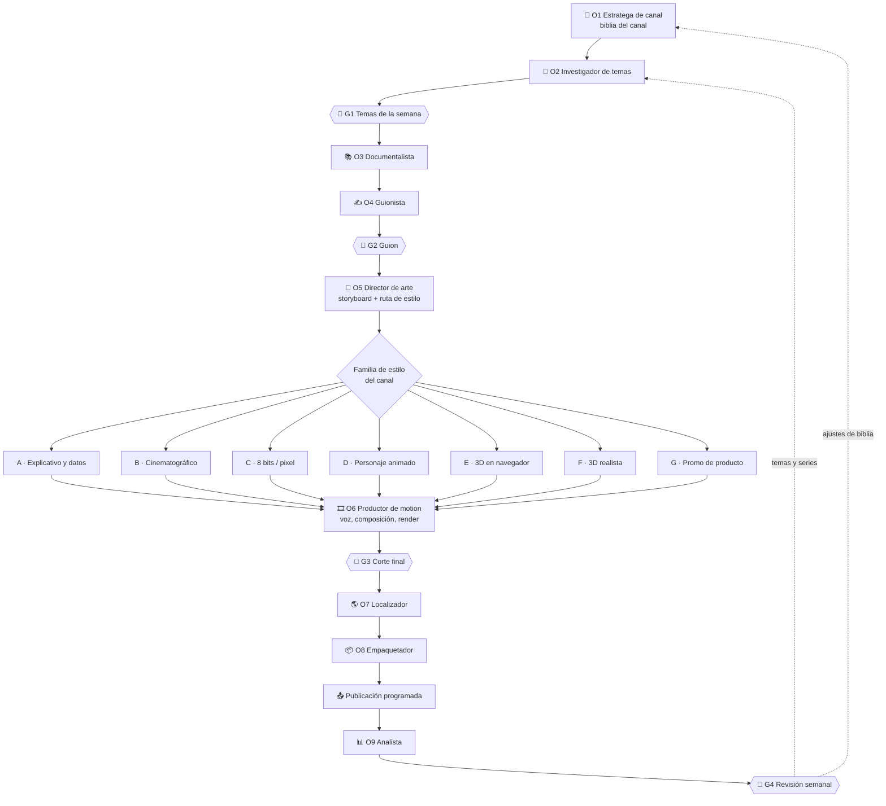

# 05 · SOP · Flujo de contenido propio

**Diseñar, producir, construir audiencia.** Fecha: 2026-11-13.

Canales faceless con guion y visuales propios. A diferencia del clipping, aquí nada existe
antes de empezar: cada pieza se diseña, y el canal se reconoce por su estilo de creación.

## 1. Mapa del flujo



| Agente | En una línea | Nivel inicial |
|---|---|---|
| O1 Estratega de canal | Define y mantiene qué es el canal | 0 |
| O2 Investigador de temas | Propone y puntúa temas | 0 |
| O3 Documentalista | Reúne y verifica los datos | 0 |
| O4 Guionista | Escribe el guion | 0 |
| O5 Director de arte | Convierte el guion en plan visual y elige la ruta | 0 |
| O6 Productor de motion | Produce el video | 1 (render) |
| O7 Localizador | Adapta a cada mercado | 0 |
| O8 Empaquetador | Prepara la publicación por plataforma | 0 |
| O9 Analista | Lee los resultados y recomienda | 0 |

## 2. Enrutamiento por estilo de creación

El paso de producción no es una sola línea: **depende de la familia de estilo del canal**.
Cada canal fija en su biblia una familia principal y, como mucho, una secundaria. El
Director de arte (O5) envía cada pieza a su rama.

| Familia | Cómo se ve | Canales donde calza | Herramienta motor | Apoyo | Esfuerzo |
|---|---|---|---|---|---|
| **A · Explicativo y datos** | Tipografía cinética, gráficos, rankings, comparativas | Finanzas, tecnología, deportes con datos | [HyperFrames](https://github.com/heygen-com/hyperframes): skill `/style-sampling` (incluye un estilo de explicativo financiero) y bloques de gráficos del registro | librosa | Medio |
| **B · Cinematográfico por estilo** | Acuarela, neón, noticiero, mapas, collage | Historias, curiosidades, noticias explicadas | [Lemo Opuscar](https://github.com/lemomo-ai/lemo-opuscar): 99 estilos, cada uno con su `STYLE.md` | Bibliotecas de prompts | Medio–alto |
| **C · 8 bits / pixel / gamer** | Pixel art, efectos de videojuego, estética retro | Gaming, cultura de internet | [pixelfx](https://github.com/patch-gg/pixelfx): 244 efectos, compuestos en HyperFrames | librosa | Bajo–medio |
| **D · Personaje animado** | Dibujo pintado a mano con un personaje que actúa | Mascota del canal, historias cortas | [Claude Animation Base](https://github.com/JohnHeibel/ClaudeAnimationBase) con personaje propio | — | Alto |
| **E · 3D en navegador** | Objetos, física, simulaciones | Ciencia, "qué pasaría si" | [Three.js](https://github.com/mrdoob/three.js) + [React Three Rapier](https://github.com/pmndrs/react-three-rapier) + [React Postprocessing](https://github.com/pmndrs/react-postprocessing) | — | Alto |
| **F · 3D realista** | Escenas cinematográficas | Piezas insignia, intros de serie | [Blender MCP](https://github.com/ahujasid/mcp-for-blender) | — | Muy alto |
| **G · Promo de producto** | Capturas reales animadas, cortes al ritmo | Afiliados, apps, herramientas de IA | [Video ShotCraft](https://github.com/Vincentwei1021/video-shotcraft): 124 recetas de plano | librosa | Medio |

### Cómo elegir la familia de un canal

| Si el canal… | Familia |
|---|---|
| Explica cifras, compara o hace rankings | A |
| Cuenta historias y quiere un look reconocible | B |
| Habla a público gamer o de internet | C |
| Vive de un personaje o mascota | D |
| Muestra cómo funciona algo físico | E |
| Reseña o recomienda productos | G |
| Necesita una pieza insignia ocasional | F como secundaria |

### Reglas del enrutamiento

1. Una familia principal por canal. Dos canales no comparten familia y estilo a la vez
   (Regla 16 de `03`).
2. Las familias D, E y F son para canales de baja frecuencia o piezas insignia: su esfuerzo
   no sostiene una publicación diaria.
3. [librosa](https://github.com/librosa/librosa) es transversal: cuando la pieza va al ritmo
   de la música, genera el mapa de golpes que guía los cortes.
4. Las bibliotecas de prompts
   ([awesome-opus5-5-videos](https://github.com/yihui-dev/awesome-opus5-5-videos),
   [opus-video-prompts](https://github.com/joeseesun/opus-video-prompts)) sirven para
   explorar estilos **antes** de fijar la biblia, no durante la producción.
5. Antes de adoptar una familia se produce una pieza de prueba y se anota su tiempo real.

### Pasos propios de cada rama

| Rama | Paso previo obligatorio | Producción | Revisión específica |
|---|---|---|---|
| A | Datos verificados y decididos qué gráficos lleva | Composición en HTML con bloques del registro de HyperFrames; render | Cifras en pantalla iguales a la ficha de datos |
| B | Estilo elegido de la galería de Lemo Opuscar; storyboard aprobado | El agente dirige y construye según `DIRECTOR.md` y `STYLE.md` | Coherencia del estilo de principio a fin |
| C | Paleta y resolución de pixel fijadas en la biblia | Efectos de pixelfx sobre composición de HyperFrames | Legibilidad del texto en pantalla pequeña |
| D | Hoja de modelo del personaje propio (vistas, emociones) | Plano a plano con hojas de contacto | Que el personaje sea consistente entre planos |
| E | Maqueta de la escena y de la cámara | Escena en Three.js; física con Rapier; acabado con Postprocessing; captura de fotogramas | Fluidez y que la física se lea a primera vista |
| F | Maqueta en baja calidad antes del render final | Blender controlado por el agente | Tiempo de render dentro de lo planificado |
| G | Capturas reales del producto y permiso o programa de afiliados | Storyboard con recetas de plano; animación en Remotion | Que lo mostrado coincida con el producto real |

Fuente del enrutamiento: los README de cada repositorio, leídos el 2026-11-12. Ninguna rama
se ha probado todavía en el estudio.

## 3. Agentes

### O1 · Estratega de canal

| | |
|---|---|
| **Misión** | Definir y mantener la biblia del canal |
| **Disparador** | Creación del canal; después, cada revisión semanal (G4) que pida cambios |
| **Entradas** | Nicho elegido, referencias, informe del Analista |
| **Salidas** | `biblia.md` |
| **Límites** | No cambia más de un elemento de la biblia por periodo (Regla 19) |
| **Fallas típicas** | Biblia genérica que serviría para cualquier canal |
| **Aprobado si** | Alguien que no conoce el canal puede producir una pieza coherente leyéndola |

**Plantilla de biblia:**

```markdown
# Biblia · <nombre del canal>
- Promesa en una frase:
- Audiencia: quién es, qué le importa, qué ya sabe
- Idioma y mercado principal:
- Tono: (3 adjetivos) · Lo que nunca hacemos:
- Familia de estilo principal: (A–G) · Secundaria:
- Estilo visual: paleta, tipografías, estilo concreto (p. ej. nombre del estilo de Lemo)
- Voz: (sintética o propia), ritmo, tratamiento (tú/usted/vos)
- Formatos: (p. ej. "3 datos en 40 s", "ranking semanal")
- Series activas:
- Duración objetivo:
- Llamado a la acción habitual:
- Fuentes de datos confiables:
- Temas vetados:
- Vía de ingreso prevista:
```

### O2 · Investigador de temas

| | |
|---|---|
| **Misión** | Mantener un backlog de temas puntuados |
| **Disparador** | Semanal, antes de G1 |
| **Entradas** | Biblia, tendencias por idioma y región, recomendaciones del Analista |
| **Salidas** | Backlog: tema, ángulo, hook, formato, puntaje, por qué ahora |
| **Límites** | No propone temas fuera de la biblia ni temas vetados |
| **Fallas típicas** | Perseguir tendencias que caducan antes de producir; repetir lo que ya hacen todos |
| **Aprobado si** | Cada tema tiene ángulo propio y una razón para producirlo ahora |

**Puntaje de tema (1–5 por criterio):**

| Criterio | Peso | Pregunta |
|---|---|---|
| Demanda | 25% | ¿La audiencia lo busca o lo comenta? |
| Diferenciación | 25% | ¿Tenemos un ángulo que otros no? |
| Esfuerzo | 20% | ¿Cabe en el tiempo de una pieza normal? (5 = poco esfuerzo) |
| Vigencia | 15% | ¿Seguirá sirviendo en un mes? |
| Potencial de ingreso | 15% | ¿Conecta con afiliados, video largo o serie? |

### O3 · Documentalista

| | |
|---|---|
| **Misión** | Que cada afirmación de la pieza tenga respaldo |
| **Disparador** | Tema aprobado en G1 |
| **Entradas** | Tema y ángulo; fuentes confiables de la biblia |
| **Salidas** | `datos.md`: afirmaciones con fuente, fecha y nivel de confianza |
| **Límites** | No rellena con datos sin fuente. Marca lo que no pudo confirmar |
| **Fallas típicas** | Cifras antiguas; citar un resumen en vez de la fuente original |
| **Aprobado si** | Cada cifra del futuro guion está en la ficha con su fuente |

### O4 · Guionista

| | |
|---|---|
| **Misión** | Escribir un guion que se sostenga de la primera a la última línea |
| **Disparador** | Ficha de datos lista |
| **Entradas** | Biblia, tema, ángulo, ficha de datos |
| **Salidas** | `guion.md` con tres variantes de hook |
| **Límites** | Solo usa datos de la ficha. No promete resultados ni da consejos personalizados (Regla 18) |
| **Fallas típicas** | Hook que promete algo que el video no cumple; relleno a mitad de pieza |
| **Aprobado si** | Leído en voz alta dura lo previsto y no sobra ninguna frase |

**Plantilla de guion:**

```markdown
# <ID> · <título de trabajo>
- Duración objetivo: 45 s (~110 palabras en español)
- Hook A: / Hook B: / Hook C:
- Desarrollo (3–4 bloques de una idea cada uno):
- Remate:
- Llamado a la acción:
- Texto en pantalla por bloque:
- Datos usados (referencia a datos.md):
```

### O5 · Director de arte

| | |
|---|---|
| **Misión** | Traducir el guion a un plan visual y enviarlo a la rama de estilo correcta |
| **Disparador** | Guion aprobado en G2 |
| **Entradas** | Guion, biblia, catálogo de `04` |
| **Salidas** | `storyboard.md`: plano por plano, con duración, texto en pantalla, movimiento, activos necesarios y rama |
| **Límites** | No cambia de familia de estilo sin pasar por la biblia |
| **Fallas típicas** | Planos demasiado ambiciosos para el tiempo disponible; texto ilegible en móvil |
| **Aprobado si** | El Productor puede construir la pieza sin tomar decisiones creativas nuevas |

### O6 · Productor de motion

| | |
|---|---|
| **Misión** | Producir el video maestro |
| **Disparador** | Storyboard listo |
| **Entradas** | Storyboard, guion, activos, herramienta de la rama |
| **Salidas** | Video maestro 1080×1920 y proyecto fuente |
| **Herramientas** | La de la rama (sección 2); voz sintética abierta o voz propia; ffmpeg |
| **Límites** | No usa música ni imágenes sin licencia. No entrega sin revisar fotogramas |
| **Fallas típicas** | Voz y texto desfasados; render que tarda más de lo previsto; consumo alto de uso del modelo |
| **Aprobado si** | Coincide con el storyboard, el audio está limpio y el texto se lee en un teléfono |

**Voz:** la opción gratuita es un motor de texto a voz abierto o la voz propia de un socio.
Qué motor suena aceptable en español queda por probar en la Ola 1.

### O7 · Localizador

| | |
|---|---|
| **Misión** | Adaptar la pieza a cada mercado sin que suene traducida |
| **Disparador** | Corte final aprobado en G3, si el canal publica en más de un mercado |
| **Entradas** | Guion, video maestro, mercado destino |
| **Salidas** | Guion adaptado y lista de cambios en pantalla por versión |
| **Límites** | No traduce literal. No localiza piezas cuyo tema no interesa en el mercado destino |
| **Fallas típicas** | Modismos de un país en otro; ejemplos y monedas que no aplican |
| **Aprobado si** | Un hablante nativo del mercado no nota que es una adaptación |

| Aspecto | Qué se adapta |
|---|---|
| Idioma | Español ↔ inglés: se reescribe el hook, no se traduce |
| Variante regional | Vocabulario y tratamiento (Chile, Argentina, México, España) |
| Referencias | Monedas, instituciones, ejemplos, personajes conocidos |
| Texto en pantalla | Todo texto quemado se regenera |
| Voz | Nueva locución por idioma |
| Decisión previa | ¿El tema importa allá? Si no, no se localiza |

Empezar con español neutro para un solo canal. Las variantes regionales solo se justifican
si los datos muestran una audiencia concentrada en un país.

### O8 · Empaquetador

| | |
|---|---|
| **Misión** | Dejar cada versión lista para publicar en cada plataforma |
| **Disparador** | Versiones finales listas |
| **Entradas** | Video, guion, biblia |
| **Salidas** | Paquete por plataforma: archivo, título, descripción, etiquetas, portada, fecha y hora |
| **Límites** | No promete en el título lo que el video no entrega |
| **Fallas típicas** | Mismo texto en las tres plataformas; marca de agua de otra plataforma |
| **Aprobado si** | Cumple la especificación de cada plataforma y la checklist de `03` |

| Plataforma | Formato | Duración | Notas |
|---|---|---|---|
| YouTube Shorts | 9:16, 1080×1920 | Hasta 3 minutos | El título pesa en la búsqueda; sirve de puerta al video largo |
| TikTok | 9:16, 1080×1920 | Variable | Su programa de pago solo cuenta videos de 60 s o más y no aplica en Chile (`02`) |
| Instagram Reels | 9:16, 1080×1920 | Variable | Sin marcas de agua de otras plataformas |

Los límites de duración cambian con frecuencia: confirmarlos en cada plataforma al publicar.

### O9 · Analista

| | |
|---|---|
| **Misión** | Convertir los resultados en decisiones |
| **Disparador** | Semanal, antes de G4 |
| **Entradas** | Métricas de cada pieza a 48 horas y 7 días; minutos de trabajo por pieza |
| **Salidas** | Informe semanal: qué funcionó, qué no, hipótesis y recomendaciones |
| **Límites** | No concluye a partir de un solo video. No recomienda cambiar más de una variable |
| **Fallas típicas** | Confundir un video viral con una tendencia; ignorar el costo en horas |
| **Aprobado si** | Cada recomendación cita los datos que la respaldan |

| Métrica | Para qué sirve |
|---|---|
| Retención media y a los 3 segundos | Calidad del hook y del ritmo |
| Vistas por pieza (mediana, no promedio) | Rendimiento típico, sin que un viral lo distorsione |
| Seguidores por mil vistas | Si el canal construye audiencia |
| Rendimiento por formato y por serie | Qué repetir |
| Minutos humanos por pieza | Capacidad y costo real |

## 4. Puertas humanas

| Puerta | Cuándo | Qué decide la persona |
|---|---|---|
| **G1** | Semanal, sobre el backlog | Qué temas se producen esta semana |
| **G2** | Tras el guion | Qué hook se usa; cambios al guion |
| **G3** | Tras el render | Si el corte final se publica |
| **G4** | Semanal, sobre el informe | Cambios de formato, series, biblia o capacidad |

**Checklist de G3:**

- [ ] Vi la pieza completa en un teléfono.
- [ ] Las cifras en pantalla coinciden con la ficha de datos.
- [ ] Voz, texto y animación están sincronizados.
- [ ] Sin música ni imágenes sin licencia.
- [ ] Cumple el tono y el estilo de la biblia.
- [ ] Control previo de `03` completo.

## 5. Cadencia semanal

| Momento | Actividad |
|---|---|
| Inicio de semana | G4 (informe de la semana anterior) y G1 (temas) |
| Primera mitad | Investigación, guiones y G2 en lote |
| Segunda mitad | Dirección de arte, producción y G3 en lote |
| Cierre | Empaque y programación de la semana siguiente |

Producir en lote y publicar programado deja un colchón de piezas: si una semana falla la
producción, el canal no se detiene.

## 6. Retroalimentación

| Hallazgo del Analista | Vuelve a |
|---|---|
| Hooks que retienen | Guionista: se vuelven patrón del canal |
| Temas y ángulos que rinden | Investigador: más de eso; candidatos a serie |
| Formato o estilo que no sostiene retención | Estratega: ajuste de biblia, un cambio a la vez |
| Piezas que cuestan demasiado tiempo | Director de arte: simplificar planos o cambiar de rama |

## 7. Tiempos a medir

Se anotan en la Ola 1; de ahí sale cuántas piezas por semana son posibles.

| Paso | Minutos por pieza |
|---|---|
| O2 · temas (por lote, dividido por pieza) | |
| O3 · datos | |
| O4 · guion | |
| O5 · storyboard | |
| O6 · voz y composición | |
| O6 · render (tiempo de máquina) | |
| O7 · localización, por versión | |
| O8 · empaque | |
| G1–G3 · revisiones | |
